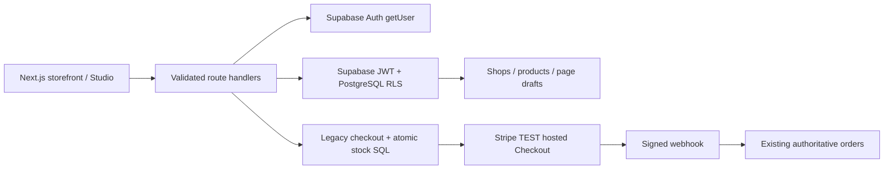

# ADR 001 — one commerce source of truth

## Update — 31 October 2026

The finance boundary below describes the earlier delivery. The current pilot adds Stripe Connect Accounts v1 Express using the existing SDK and the still-documented hosted-onboarding path. A single maker is settled per hosted Checkout Session, using destination charges and a 550 bps application fee on discounted product value, excluding shipping. A multi-maker cart is paid maker-by-maker; no combined charge/transfer worker is claimed. Fees, orders, fulfillment, reviews/returns and tenant-owned uploads are persisted in Supabase. Signed platform/connected-account webhooks retrieve current provider state, and refunds reverse transfers/application fees. No live keys are accepted. This incremental strategy supersedes the earlier blanket block on new-seller checkout only after migrations and Stripe readiness are verified; Medusa/Accounts v2 migration and multi-maker settlement remain separate milestones. See [PRODUCTION-LAUNCH.md](../PRODUCTION-LAUNCH.md).

Date: 2026-10-30. Status: accepted for the incremental delivery.

## Options

| Option | Reuse / cost | Decision |
|---|---|---|
| A. Extend custom Next.js + Supabase | Preserves identities, product IDs, stock SQL, checkout and deployment. Marketplace finance remains substantial bespoke work. | Current runtime source of truth while tenant model is introduced. |
| B. Immediate Medusa v2 / Mercur | Commerce workflows and marketplace modules are useful; requires an API/worker, managed Redis, new auth mapping, product/order migration and a checkout cutover. | No immediate rewrite. |
| C. Staged migration | Ship seller identity/storefronts in Supabase; prove a Medusa import and identity exchange in staging, then switch all commerce operations together. | Long-term direction, with an explicit gated milestone. |

Medusa's official recipe defines vendor models, module links to products/orders, protected vendor routes, and a custom complete-cart workflow to split orders. It does not make marketplace isolation or payouts automatic. [Recipe](https://docs.medusajs.com/resources/recipes/marketplace), [vendor example](https://docs.medusajs.com/resources/recipes/marketplace/examples/vendors).

Mercur provides a marketplace layer on Medusa and uses an [MIT license](https://github.com/mercurjs/mercur/blob/main/LICENSE). Evaluate its vendor panel, commissions and payout workflows in a pinned staging version before adoption; upstream feature claims do not prove our Romanian currency, identity, accounting or refund requirements. Reuse backend modules if the spike succeeds; retain this storefront. [Architecture](https://github.com/mercurjs/mercur/blob/main/docs/ARCHITECTURE.md).

## Ownership today

Supabase owns products, inventory, orders, customer data, shop membership and appearance. Stripe owns payment/card processing. Next.js is the BFF; seller requests use a verified Supabase JWT and RLS, not the service key. Operator actions additionally require the server email allowlist and use restricted SQL functions. Published storefront JSON is a snapshot separate from private drafts. No Medusa tables or duplicate order pipeline are introduced.

## Payments boundary

New seller listings may be approved for discovery but cannot enter checkout until payout readiness and split-order accounting exist. Legacy products remain purchasable through the original operator. A product's maker label never establishes a payout entitlement.

For mixed-seller checkout, target separate charges and transfers: one charge on the platform and one transfer per eligible connected account, integer minor-unit snapshots and an immutable ledger/outbox. Refund and transfer reversal must be reconciled separately. Stripe documents platform responsibility for fees/refunds with this model. Use current Accounts v2 for a fresh integration and retrieve capabilities from Stripe; a return URL is not verification. Country/currency and platform liability must be confirmed against the actual account before activation. [Charge strategy](https://docs.stripe.com/connect/separate-charges-and-transfers), [Accounts v2](https://docs.stripe.com/connect/accounts-v2).

## Medusa migration gate and rollback

Keep Supabase Auth UUIDs; build and security-test a server identity mapping before any Medusa session issuance. Import product IDs/stock/order snapshots into isolated staging, verify rounding/reservations/refunds and compare counts and balances. During cutover freeze commerce writes, take a backup, reconcile open Stripe sessions, switch the commerce adapter once, then unfreeze. Never dual-write. Rollback before accepting new orders restores the old adapter; after new financial writes, reconcile/export those writes before rolling back. Supabase-hosted Postgres compatibility, schema privileges, transaction pooling and worker locks are unproven and must be tested; prefer a separate Medusa database for the spike.

## Deployment

Current slice: Vercel Next.js + Supabase, no worker required for drafts/membership. Future commerce: Railway/Render for Medusa and an always-on outbox worker, managed Redis if required. These add operational cost; do not install them before the migration and Connect milestones are executable.
